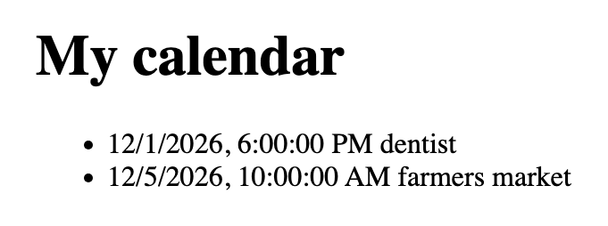

# Private Calendar (TypeScript, Spaces)

This folder contains the completed app from the [Build a Private App](https://atproto.com/guides/private-app-tutorial) tutorial. It stores calendar events in a personal [Space](https://atproto.com/guides/spaces) that only you (and apps you authorize) can read, using the [Lexicon Community](https://lexicon.community/) calendar Lexicons and the Spaces TypeScript SDK.

- `src/calendar.ts` logs in and opens (or creates) your personal calendar space
- `src/index.ts` is a CLI to add, remove, and list events
- `src/server.ts` serves your calendar as a web page

## Set Up

You'll need Node.js 22+ and an account on a PDS that supports Spaces.

App passwords can't access spaces, so this example logs in with your full account password. Use a test account. Production apps should use [OAuth](https://atproto.com/guides/auth).

1. Install dependencies: `npm install`
2. Install and build the calendar Lexicons: `npm run lex`
3. Make a copy of the example `.env` file: `cp example.env .env`, and fill in your PDS URL, handle, and password.

## Running the app

Add some events, then list them:

```bash
npm run cli -- add 2026-12-01T18:00 dentist
npm run cli -- add 2026-12-05T10:00 farmers market
npm run cli
```

Remove an event by its record key: `npm run cli -- rm <rkey>`

To view your calendar in a browser, run `npm start` and open `http://127.0.0.1:3000`.


