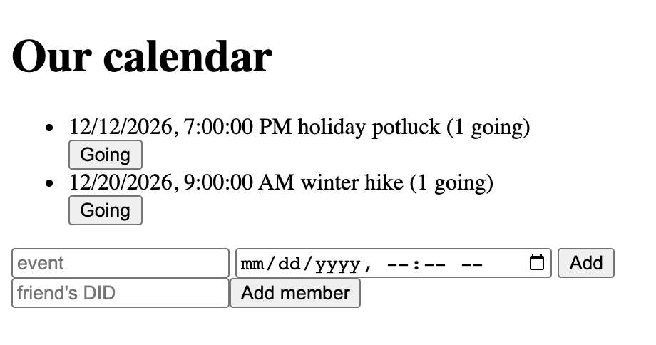

# Shared Calendar (TypeScript, Spaces)

This folder contains the completed app from the [Build a Shared Space App](https://atproto.com/guides/shared-space-tutorial) tutorial. One account hosts a calendar as a [Space](https://atproto.com/guides/spaces) and adds friends as members. Everyone can post events and RSVP to them. Each person's records are stored in their own repo on their own PDS, and the app syncs all of them into one view with [jetstream-spaces](https://atproto.com/guides/space-sync).

- `src/calendar.ts` creates and opens the calendar space, and adds members
- `src/sync.ts` sets up the OAuth client and the `SpaceSyncController` that connects to jetstream-spaces
- `src/indexer.ts` reads events and RSVPs from jetstream-spaces into memory
- `src/pages.ts` renders the HTML
- `src/server.ts` handles logging in, adding events, RSVPs, and members, and showing the calendar

## Set Up

You'll need:

- Node.js 22+ and Go
- Two accounts on a PDS that supports Spaces: one to host the calendar, and one for a friend
- A public HTTPS address that forwards to port `3004`, so the PDS can notify jetstream-spaces of new writes. For local development, you can use [Cloudflare Tunnel](https://developers.cloudflare.com/cloudflare-one/connections/connect-networks/do-more-with-tunnels/trycloudflare/), [ngrok](https://ngrok.com/docs/), or [Tailscale Funnel](https://tailscale.com/kb/1223/funnel).

1. Install dependencies: `npm install`
2. Install and build the calendar Lexicons: `npm run lex`
3. Make a copy of the example `.env` file: `cp example.env .env`, and set `HOST_DID` to the DID of the account that will host the calendar.

## Running jetstream-spaces

From this folder, clone and build jetstream-spaces next to it, and create a secret that the app and jetstream-spaces will share:

```bash
git clone https://github.com/bluesky-social/jetstream-spaces ../jetstream-spaces
(umask 077; openssl rand -hex 32 > broker-secret)
cd ../jetstream-spaces
go build -o jetstream-spaces ./cmd/jetstream-spaces
```

Then run it, replacing `https://sync.example.com` with your public HTTPS address:

```bash
./jetstream-spaces \
  --public-origin https://sync.example.com \
  --notification-listen :3004 \
  --listen 127.0.0.1:3002 \
  --broker-token-file ../ts-shared-calendar/broker-secret \
  --public-jetstream-url https://jetstream.us-east.bsky.network/ \
  --data-dir ./data
```

Leave it running in a terminal.

## Running the app

In this folder, run `npm start` and open `http://127.0.0.1:3000`. Log in as the host first; this creates the calendar.

Add your friend's DID as a member, then log in as them in another browser or a private window. Add an event as one account and RSVP to it as the other. New events and RSVPs appear once jetstream-spaces syncs them, so refresh to see them.

Sessions are stored in memory, so restarting the app signs everyone out.


